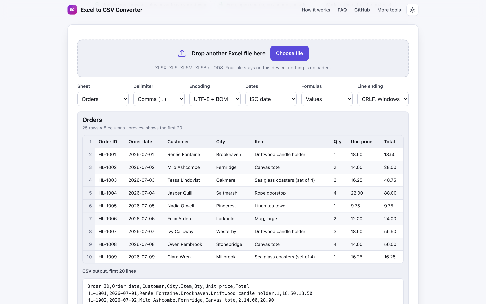
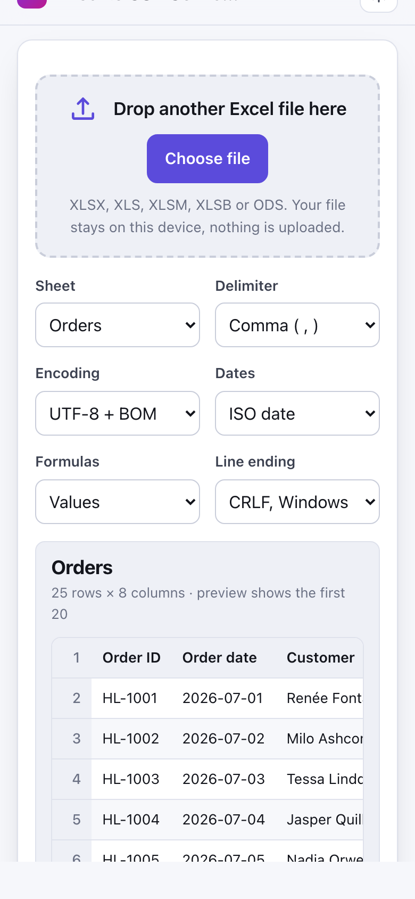

# Excel to CSV Converter

> Convert XLSX and XLS sheets to clean CSV in your browser, pick the sheet and delimiter, nothing uploaded.

**🌐 Use it now: [turhe123.github.io/excel-to-csv-local](https://turhe123.github.io/excel-to-csv-local/)** · free · open source · runs in your browser · works offline


## Why

Spreadsheets often hold customer lists, payroll or invoices, and many online converters work by uploading the file to a server. Convertio Excel to CSV, for example, uploads your spreadsheet, caps the free plan at 100 MB and 10 conversions a day, shows ads and asks for a sign-up for more. This is a free, open-source alternative: your files never leave your device, there is no account, no ads and no limits, it works offline, and it can be installed as an app.

## Screenshots

<p align="center"></p>

<p align="center"><em>Excel to CSV Converter in the browser, light theme</em></p>

<p align="center"></p>

<p align="center"><em>Excel to CSV Converter on a phone</em></p>

## Features

- Drop a file on the page or choose it with the keyboard-accessible file input.
- Lists every sheet in a selector; hidden sheets are labelled "(hidden)".
- Choose the delimiter: comma, semicolon, tab or pipe.
- Choose the line ending: CRLF (Windows) or LF (Mac/Linux).
- Choose UTF-8 with a byte order mark (so Excel opens accents correctly) or UTF-8 without.
- Write dates as ISO dates or as displayed text.
- Export formulas as their computed values or as formula text.
- Preview of the first 20 rows as a table, plus the first CSV lines as plain text, with row and column counts.
- Download the sheet as a CSV named after the source file and sheet, for example `orders-q3-Orders.csv`.
- Copy the CSV to the clipboard.
- Download every sheet as its own CSV file.
- Files over 5 MB are parsed in a Web Worker with a progress message, so the page stays responsive.
- Warns about memory on very large sheets (mobile Safari in particular).
- Friendly, visible errors for files that are not spreadsheets or cannot be read.
- Installable and usable offline.

**Input formats:** XLSX, XLSM, XLSB, XLTX, XLTM, XLS, ODS, FODS (one workbook at a time).
**Output:** CSV, UTF-8, one sheet per file.
**Limits:** no fixed size limit; the practical limit is your device's memory.

## How to use

1. Drop a spreadsheet on the page or press **Choose file**.
2. Pick the sheet, delimiter, line ending, encoding, date format and formula handling. The preview updates as you change them.
3. Check the preview of the first 20 rows.
4. Press **Download** to save the CSV, **Copy to clipboard** to copy it, or **Download every sheet** to save one CSV per sheet.

## Privacy

- Nothing is uploaded. The file is read and converted in your browser.
- No cookies.
- Page views are counted anonymously with [GoatCounter](https://www.goatcounter.com/) (cookieless, open source).
- Works offline through a service worker.

## Run it locally

```sh
git clone https://github.com/turhe123/excel-to-csv-local
cd excel-to-csv-local
python3 -m http.server 4173
```

Then open http://127.0.0.1:4173/. There is no build step.

## Tests

```sh
npm i -D @playwright/test && npx playwright install chromium
npx playwright test
```

## Third-party code

- [SheetJS (xlsx)](https://sheetjs.com/) 0.20.3, Apache-2.0, in `vendor/xlsx/`.

## Built with AI

Excel to CSV Converter was written by [Claude Code](https://claude.com/claude-code) inside an automated pipeline, from a plain-English spec. No code or assets from any commercial product were used; it is a clean-room implementation of a feature set, not a copy.

What that means in practice:

- The full source is in this repo under the MIT license. Read it before you trust it with your files.
- Everything runs in your browser. It makes no network requests except an anonymous, cookieless page-view count (GoatCounter); your files never leave the device.
- The page is tested headless in Chromium (Playwright) before every release, but it has had less human review than hand-written software. Bug reports and pull requests are welcome.

## Support ❤️

If this saved you time, you can support the project on [Ko-fi](https://ko-fi.com/leodavidai).

## More free web tools

See [turhe123.github.io/web-tools](https://turhe123.github.io/web-tools/).

## License

MIT © Or Davidai Bachar
